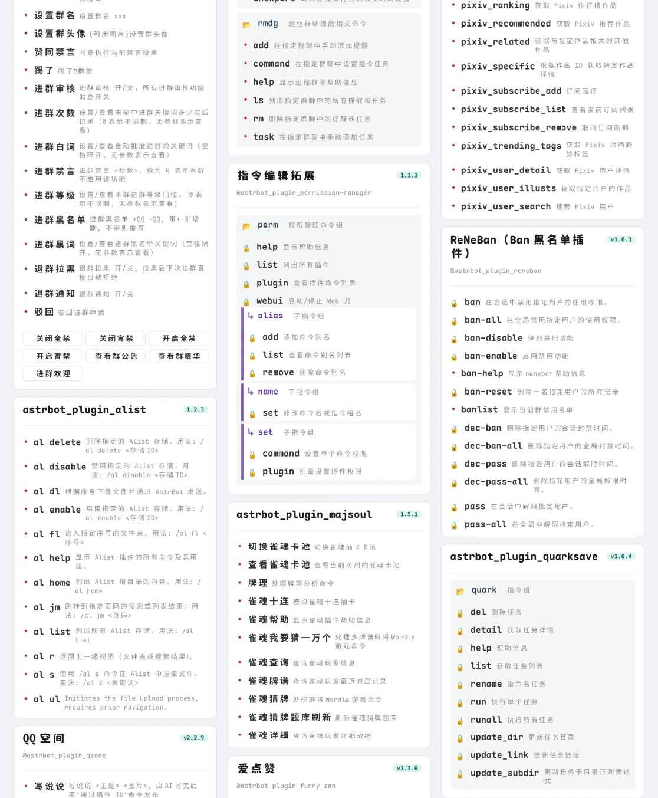
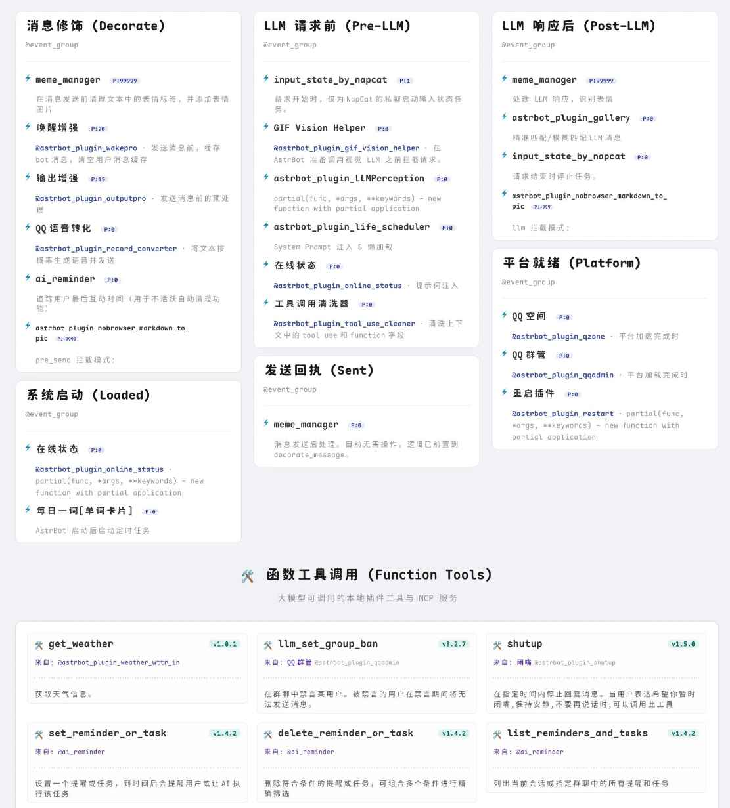
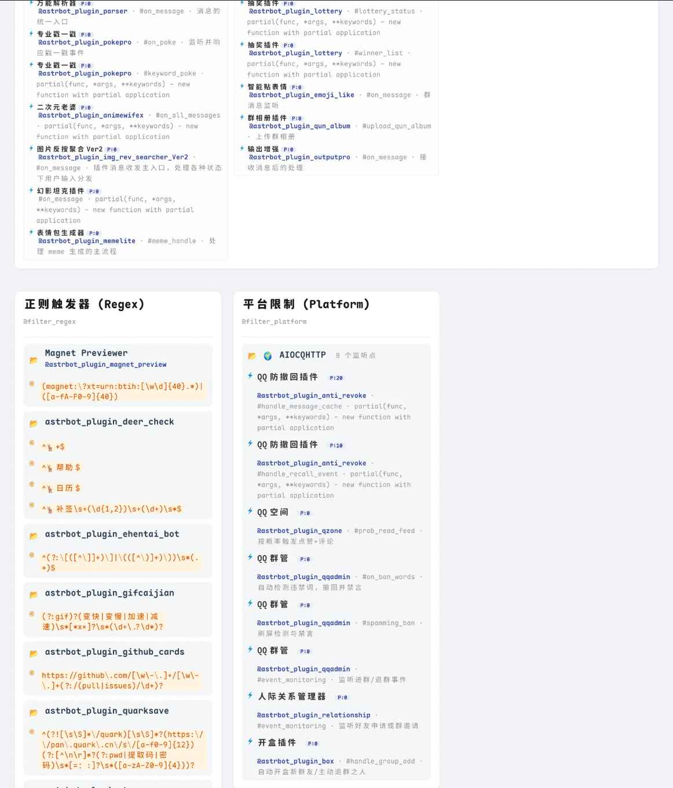
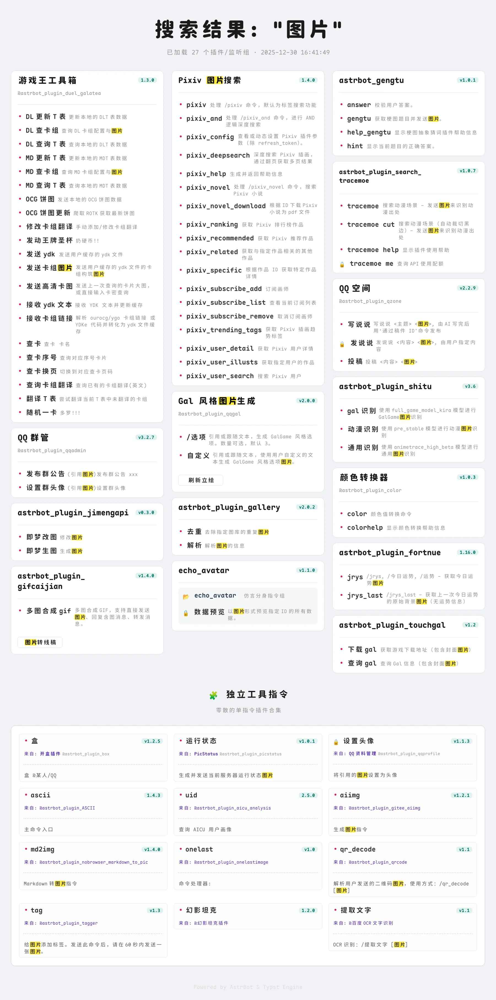

# 📂︎ AstrBot Plugin Help Typst — Typst Plugin Menu

[简体中文](README.md) · [繁體中文](README.zh-TW.md) · **English**

[](https://github.com/Soulter/AstrBot) [](https://www.python.org/)

An elegant, cached **AstrBot plugin menu**, with detailed metadata and debugging features rendered using Typst.

## Features

- Extensively adapts [tinkerbellqwq/astrbot_plugin_help](https://github.com/tinkerbellqwq/astrbot_plugin_help), adding caching.
- Renders plugin menus, event hooks, LLM function tools and filters in a friendly layout with grouping and metadata, useful for both bot users and developers.
- Searches plugin/command names and descriptions with keyword highlighting: `helps/events/filters <keyword>`.
- Lightweight Typst rendering; custom Typst templates are **work in progress**.
- Supports `.ttf`, `.otf` and `.woff2` font files. Place them under `resources/fonts` or a custom directory, then reload from AstrBot WebUI, restart AstrBot, or run `typst font` to refresh the font list. Enabled fonts can be selected and ordered in settings; missing ones are automatically ignored.

## Screenshots

| Plugin menu | Event listeners |
| :---: | :---: |
|  |  |

| Filters | Search |
| :---: | :---: |
|  |  |

## Requirements

- AstrBot **4.10.4+**
- Typst **0.14.7+**
- `pydantic`

## Font precedence and FAQ

Precedence: **explicit document font → project font folder → system fonts**.

- Explicit document choice: `#set text(font: "font-family-name")`; highest priority.
- Plugin font folders: `./resources/fonts` and an optional custom folder. Default custom path: `.../data/plugin_data/astrbot_plugin_help_typst/fonts`. Docker deployments must mount the custom font directory.
- System fonts: use OS defaults. Windows/macOS have expected support; Linux support is not fully verified and Docker environments may need font packages.

## Roadmap

- Custom configuration items.
- Background and template configuration are in progress.
- Blacklist feature was crossed off; command blacklist management is still planned.
- Full formal documentation is pending.

## Intended file structure (preliminary)

```text
astrbot_plugin_typst_menu/
├── main.py
├── domain/
│   ├── constants.py
│   ├── config.py
│   └── schemas.py
├── utils/
│   ├── hash.py
│   ├── font.py
│   ├── image.py
│   └── views.py
├── core/
│   ├── analyzer.py
│   ├── renderer.py
│   └── worker.py
├── templates/base.typ
└── resources/
    ├── fonts/
    └── images/
```

This was a **proposed layout** in the source README; it is not proof that every path is implemented.

## Credits, upstream and licensing

Thanks to PR contributor [Zhalslar](https://github.com/Zhalslar). The original README credits **LilDawn**.

This repository is a fork of [bylkuse/astrbot_plugin_help_typst](https://github.com/bylkuse/astrbot_plugin_help_typst). The **upstream licensing status is AGPL-3.0**; preserve its applicable notices. An MIT badge in a README does not by itself relicense upstream code. Fork modifications cannot claim upstream work as new or extend licensing to third-party assets and dependencies.
