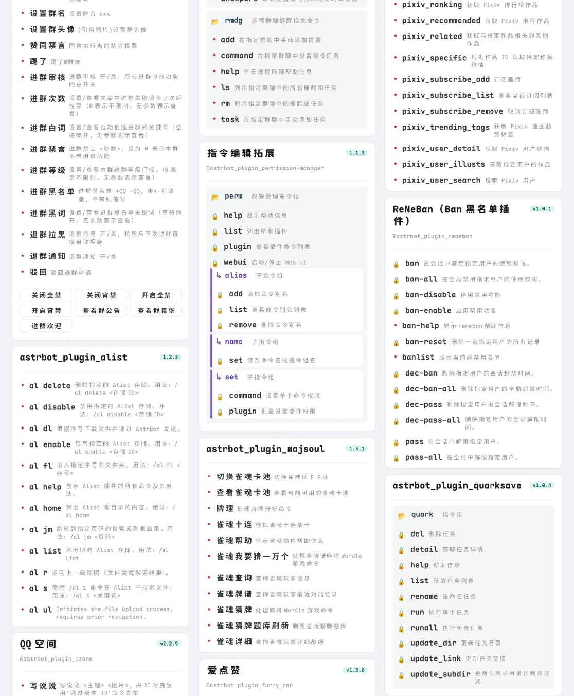
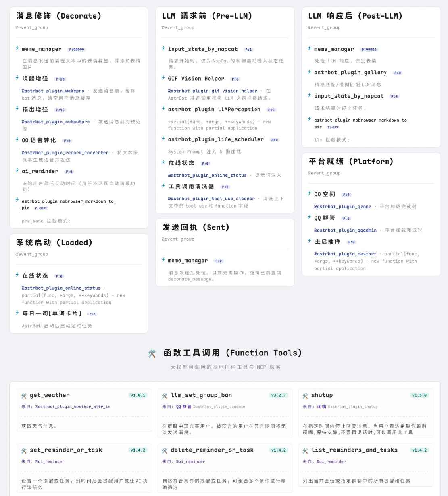
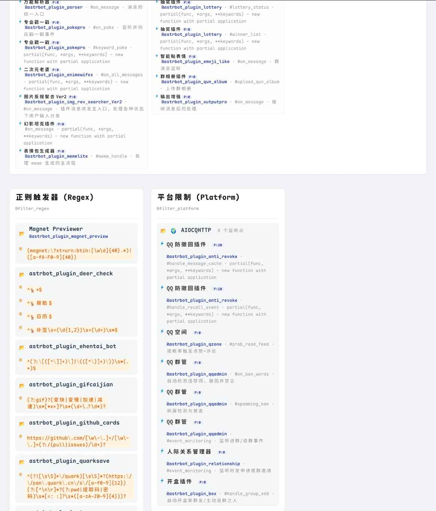
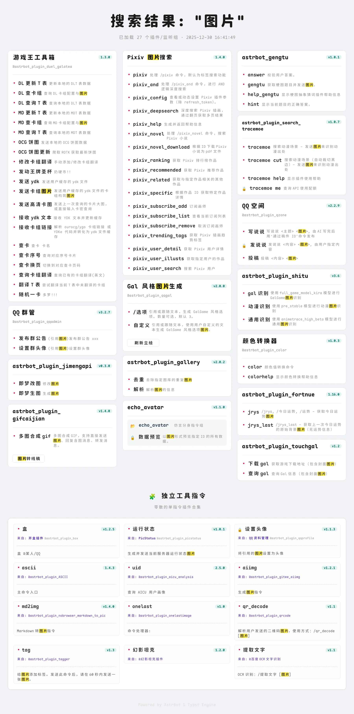

# 📂︎ AstrBot Plugin Help Typst — Typst 插件選單

[简体中文](README.md) · **繁體中文** · [English](README.en.md)

[](https://github.com/Soulter/AstrBot) [](https://www.python.org/)

**優雅地整理你的 AstrBot 插件選單**，兼具輕量渲染、豐富元資料及調試用途。

## 功能

- 深度延伸 [tinkerbellqwq/astrbot_plugin_help](https://github.com/tinkerbellqwq/astrbot_plugin_help)，加入快取。
- 以友善排版呈現插件選單、事件鉤子、LLM 函式工具和過濾器，具備節點分組與詳細資訊，可供使用者查詢及開發者除錯。
- 支援搜尋插件名稱、指令及說明，並醒目標記關鍵字：`helps/events/filters <關鍵字>`。
- 使用 Typst 輕量高效地渲染；可自訂 Typst 模板（持續開發）。
- 可使用 `.ttf`、`.otf`、`.woff2` 字型。字型放在 `resources/fonts` 或自訂目錄，透過 AstrBot 面板重新載入、重新啟動 AstrBot 或執行 `typst font` 更新字型清單；配置頁可勾選並排序，無效字型會被移除。

## 預覽

| 插件選單 | 事件監聽器 |
| :---: | :---: |
|  |  |

| 過濾器 | 搜尋 |
| :---: | :---: |
|  |  |

## 相依要求

- AstrBot **4.10.4+**
- Typst **0.14.7+**
- `pydantic`

## 字型優先權與常見問題

優先順序：**文件明確指定 → 項目字型目錄 → 系統字型**。

- 文件指定：使用 `#set text(font: "font-family-name")`，優先權最高。
- 插件字型：`./resources/fonts` 或額外自訂目錄，預設自訂路徑為 `.../data/plugin_data/astrbot_plugin_help_typst/fonts`。Docker 使用者必須確認此目錄已掛載。
- 系統字型：使用作業系統字型目錄。Windows、macOS 一般可用；Linux 的支援程度未完整測試，Docker 可能需要安裝字型。

## 已知計畫

- 自訂配置項目。
- 背景配置及模板配置仍在開發。
- 黑名單功能已劃除；指令黑名單管理仍待完成。
- 更完整的正式說明文件仍待撰寫。

## 專案結構（初步規劃）

```text
astrbot_plugin_typst_menu/
├── main.py
├── domain/
│   ├── constants.py
│   ├── config.py
│   └── schemas.py
├── utils/
│   ├── hash.py
│   ├── font.py
│   ├── image.py
│   └── views.py
├── core/
│   ├── analyzer.py
│   ├── renderer.py
│   └── worker.py
├── templates/base.typ
└── resources/
    ├── fonts/
    └── images/
```

此結構是原 README 的**初步規劃**，不代表所有檔案均已實作。

## 致謝與來源授權

感謝 PR 貢獻者 [Zhalslar](https://github.com/Zhalslar)。原項目說明署名 **LilDawn**。

本倉庫是 [bylkuse/astrbot_plugin_help_typst](https://github.com/bylkuse/astrbot_plugin_help_typst) 的 fork。**上游授權狀態：AGPL-3.0**；應保留適用的上游聲明。若 README 的 MIT badge 與上游授權不同，不能依此認定上游內容已被重新授權。分支修改不得冒認上游作者成果或擴大第三方內容授權。
